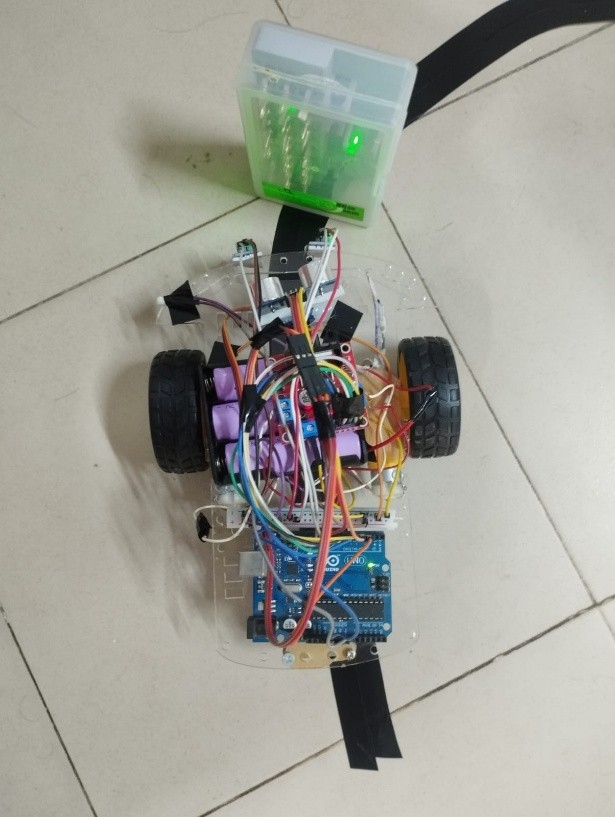

# Line Following and Obstacle Avoidance Robot

An Arduino Uno robot that follows a black line using two IR sensors and avoids an obstacle on the track using an HC-SR04 ultrasonic sensor mounted on a servo. When the path ahead is blocked, the robot stops, looks to the right and to the left with the servo, and drives around the obstacle on the side with more free space.

Lab experiment (Experiment 09), Department of Electrical and Electronic Engineering, Rajshahi University of Engineering & Technology (RUET).



## How it works

The control loop reads the front distance and the two IR sensors, then decides one action:

| Right IR | Left IR | Action |
| --- | --- | --- |
| LOW | LOW | Go forward if the front distance is above the threshold, otherwise run the obstacle routine |
| HIGH | LOW | Turn right (right wheel reverses, left wheel forwards) |
| LOW | HIGH | Turn left (left wheel reverses, right wheel forwards) |
| HIGH | HIGH | Stop |

In the sketch, HIGH means a sensor is over the black line and LOW means it is over the white surface. The two sensors straddle the line, so the robot goes straight while both see white and steers back as soon as one of them reaches the line.

**Obstacle routine (`Check_side`):**
1. Stop.
2. Turn the servo to the right and measure the distance, then to the left and measure again, then return the servo to the centre.
3. Compare the two distances and go around the obstacle on the side with more space (turn, move forward, turn back, move forward, turn), using fixed-duration moves.
4. Return to the line-following loop.

**Distance measurement:** the HC-SR04 is triggered with a 10 microsecond pulse and the echo time is converted with `distance (cm) = echo time (us) x 0.034 / 2`. If no echo arrives within 25 ms, the reading is set to 999 cm. The obstacle threshold is `OBSTACLE_DIST_CM` (5 cm).

**Servo:** driven with software-generated pulses (`servoPulse`), so the `Servo.h` library is not needed.

**Motors:** each motor has an enable pin (PWM speed) and two direction pins. The speed is `MOTOR_SPEED` (110 out of 255). Positive values drive forward, negative values drive backward, and zero stops the motor.

**Serial output (9600 baud):** the front distance is printed every loop as `D F=`, and the side distances as `D R=` and `D L=` during the obstacle routine.

## Hardware

| Part | Quantity | Notes |
| --- | --- | --- |
| Arduino Uno | 1 | ATmega328P, 5 V, 16 MHz |
| L293D-based motor driver | 1 | Enable and direction pins driven directly from the Uno |
| DC motors with rubber wheels | 2 | 6 V |
| IR sensor module | 2 | Digital output, adjustable sensitivity |
| HC-SR04 ultrasonic sensor | 1 | 2 cm to 400 cm range |
| SG90 mini servo | 1 | Carries the ultrasonic sensor |
| Li-ion battery, 3.7 V 2000 mAh | 3 | Power source |
| Acrylic robot chassis | 1 | Two layers |
| Jumper wires and breadboard | | |

## Pin map

| Function | Arduino pin |
| --- | --- |
| Right IR sensor | 11 |
| Left IR sensor | 12 |
| Right motor enable (PWM) | 6 |
| Right motor direction | 7, 8 |
| Left motor enable (PWM) | 5 |
| Left motor direction | 9, 10 |
| Servo signal | 3 |
| HC-SR04 trigger | 13 |
| HC-SR04 echo | 4 |

## Build and run

1. Open `line-following-robot.ino` in the Arduino IDE and select the **Arduino Uno** board.
2. No external libraries are required.
3. Wire the parts according to the pin map above and upload the sketch.
4. Place the robot on a black tape line on a light floor and power it from the battery pack.
5. Adjust the sensitivity potentiometers on the IR modules until each module's indicator LED switches reliably between the white floor and the black line.
6. Place an obstacle on the track to test the avoidance routine. Open the Serial Monitor at 9600 baud to see the measured distances.

## Test setup

The robot was tested on a black tape track on a white floor, with straight sections and a 90 degree turn, and with an obstacle placed on the line. The photo above shows the robot on the track. The full experiment report is in the `docs` folder.

## Notes and limitations

- The obstacle manoeuvre uses fixed-duration moves, so it does not measure the distance travelled or the angle turned. It works best with a single obstacle of moderate size.
- The robot stands still during the whole obstacle routine because the servo scan includes long waits.
- If both IR sensors read HIGH (line lost), the robot stops and does not search for the line.
- `TCCR0B` is changed in `setup()` to raise the PWM frequency on pins 5 and 6. As a side effect, `delay()` runs faster than its nominal time, so the delays in the code are not exact milliseconds.
- The speed and the timings were tuned for this chassis and battery pack. A different robot will need new values.

## Repository contents

```
line-following-robot/
  line-following-robot.ino   Arduino sketch
  docs/                      Experiment report (PDF)
  images/                    Photos of the robot
  README.md
```

## Author

Md. Raiyan Mahmud, EEE, RUET. Portfolio: https://raiyan2064.github.io
